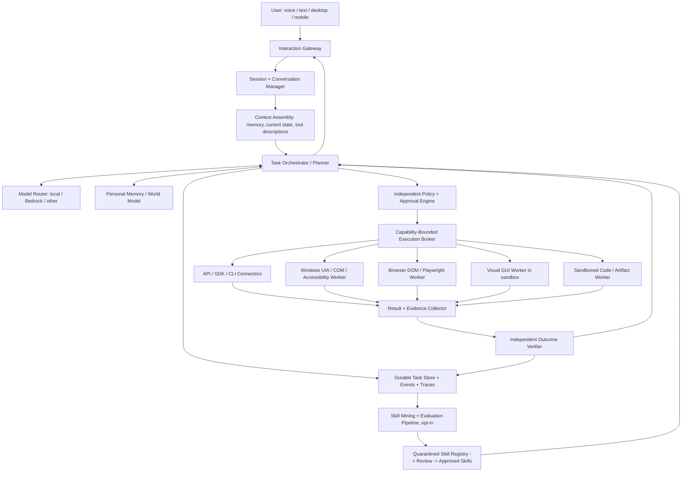

# PROJECT JARVIS — Personal AgentOS
## Master Blueprint, Product Requirements, System Architecture, Research Roadmap, and Cursor Build Instructions

> **Document type:** Living engineering specification / master context for a coding agent  
> **Revision:** 1.0 — 2026-11-05  
> **Primary deployment:** Personal Windows workstation, with optional isolated local services and AWS cloud augmentation  
> **Design philosophy:** Local-first, cloud-augmented, secure by construction, verifiable action, measurable improvement  
> **Status:** Proposed architecture. Technologies and goals are hypotheses until validated on the actual workstation.

---

# 0. READ THIS FIRST — INSTRUCTIONS FOR CURSOR / CODING AGENT

You are implementing **JARVIS**, a serious, research-oriented personal AI operating layer. This is not a chatbot wrapper and not a toy demo. Use this specification as the source of design intent, **not** as permission to build the entire roadmap in one pass.

**Your first action when handed this file:**

1. Inspect the existing repository, if any; do not overwrite working code. Determine OS, Python/Node/.NET versions, GPU model/VRAM, memory, installed runtimes, network constraints, and the user's preferred model access. Report findings in `docs/ENVIRONMENT.md`; never dump secrets or credentials.
2. Produce a short `docs/IMPLEMENTATION_PLAN.md`: architecture decisions, implementation order, initial benchmark, dependencies, risks, and tests. Make explicit any unverified assumptions.
3. Implement **Phase 0 and Phase 1 only** initially, through small reviewable increments. Do not build every advanced feature before the execution kernel works.
4. Prefer interfaces/adapters and feature flags. Components must be independently testable, replaceable, and measurable.
5. Never enable broad operating-system automation, unrestricted shell, remote access, production accounts, secret reading, or autonomous external communication by default.
6. Start in **Observe** mode. `Assist` and `Delegate` modes are opt-in, scope-limited, and enforced by the policy engine outside the LLM.
7. Write tests before permitting any mutation-capable adapter. Use fake/mock adapters and an isolated test workspace. Do not touch the owner's actual personal/business files as test fixtures.
8. After each milestone, report what works, what is simulated, known limitations, measured performance, and the exact next small increment.
9. Never claim “self-learning,” “verified,” “safe,” or “production ready” without a concrete mechanism and evaluation evidence.
10. Keep this document under version control, update ADRs when decisions change, and maintain a separate changelog for empirical findings.

**Hard delivery rule:** Reliable action and independent verification come before visual polish, anthropomorphic personality, or multi-agent complexity.

## Definition of the project

JARVIS = a long-lived, permission-aware personal software agent that can accept multimodal intent, understand personal context, plan bounded tasks, execute actions through appropriate system interfaces, verify observable outcomes, preserve useful memories, learn repeatable procedures under supervision, and optimize reliability/latency/cost over time.

It should feel conversationally natural and demonstrate superhuman *software capabilities* (fast retrieval, parallel research, tireless consistency) without pretending to be conscious or infallible.

---

# 1. VISION AND PRODUCT BOUNDARIES

## 1.1 Ideal user experience

Sample request:

> “Jarvis, prepare me for tomorrow's meeting. Find the relevant emails and project files, check our code progress, identify unresolved technical questions, research missing details, prepare a briefing, and leave a draft presentation ready for review.”

Desired operation:

- Resolves which meeting and project are meant; asks one targeted question only if materially ambiguous.
- Retrieves approved context with provenance, timestamps, and access boundaries.
- Creates a task graph with parallelizable subtasks and checkpoints.
- Selects deterministic APIs/CLI for retrieval and file creation, UI automation for unsupported apps, and visual grounding as a fallback.
- Observes current state before mutations; avoids repeating completed steps after interruption/restart.
- Uses a temporary workspace for experiments, code, document assembly, and testing.
- Checks the produced report against source evidence and the actual file artifacts.
- Requests approval before sending anything or affecting external systems.
- Can be interrupted naturally: “Focus on deployment cost first”; revises the graph while retaining completed work.
- Gives a concise spoken update, with comprehensive details visible in the desktop UI.

## 1.2 Product goals

**G1 — Useful every day.** Perform bounded real work: search/summarize, research, repo review, draft artifacts, safe local workflows, calendar preparation.

**G2 — Reliable computer operator.** Operate multiple apps with an explicit verification loop and safe recovery instead of blindly clicking.

**G3 — Natural conversation.** Low-perceived-latency voice, interruption/barge-in, context retention, natural but concise responses, text fallback.

**G4 — Private by default.** On-device wake detection; least-privilege connectors; clear consent and data retention.

**G5 — Economically sustainable.** Spend expensive model/voice compute only when quality justifies it; exploit deterministic skills and local compute.

**G6 — Research playground.** Allow controlled experimentation on memory, perception, skill induction, action models, model routing, and agent-native environments.

**G7 — Evolvable.** Backends, models, UI adapters, tools, and workers are replaceable without rewriting the core system.

## 1.3 Non-goals for the initial build

- General unrestricted access to the user's real desktop, bank, business accounts, or OS administrator privileges.
- An invisible permanent microphone recorder or a permanently connected cloud audio stream.
- Unsupervised outbound email, social posting, payments, deployments, destructive edits, or privilege changes.
- Training a frontier foundation model from scratch.
- “Human-level” autonomy claims or sentient persona claims.
- Dozens of agents that duplicate responsibilities and add orchestration overhead.
- Cloud-hosting the personal Windows desktop to save a few lines of integration code.

## 1.4 Operating constraints

- **Primary OS:** Windows (validate Windows version and build).
- **Hardware:** Good personal workstation but exact CPU/GPU/VRAM/RAM unknown. Benchmark first; no invented GPU requirements.
- **Cloud:** AWS available, Bedrock preferred for cloud experimentation where quotas, policies, region, availability, privacy and credit eligibility permit. Do not assume any specific model is currently enabled.
- **Development:** Python, TypeScript/React/Electron, and .NET/C# are natural starting choices, but adapters may be replaced based on measured results.
- **Business separation:** JARVIS is a personal project. Business/client data is never imported without permission and appropriate handling. Keep personal and company account scopes isolated.

---

# 2. PRINCIPLES / NON-NEGOTIABLE INVARIANTS

1. **Execution is not reasoning.** LLMs plan/propose; trusted deterministic services authorize/execute/verify.
2. **API > structured UI > visual UI.** Prefer official APIs, local SDKs, CLI, COM/UI Automation, accessibility tree/DOM, then screenshot-grounded mouse/keyboard.
3. **The system never trusts the content it reads as instructions.** Email/webpage/README/PDF content is untrusted task data, not permission to alter goals or tool policy.
4. **No action without provenance and scope.** Every action has an originating request, tool ID, arguments, policy decision, evidence and result.
5. **Least privilege, even for a single-user system.** Access tokens scoped by connector, folder, action and time; sensitive changes require explicit authorization.
6. **Verifiable outcomes.** “Tool returned success” is not enough; check destination state or resulting artifact with a suitable independent condition.
7. **Uncertainty is a first-class type.** Distinguish observed/confirmed, inferred, uncertain, stale, and contradictory information.
8. **Persist before acting.** Durable tasks, idempotency keys, and checkpoints to avoid duplicate work on retry/resume.
9. **Local idle is cheap.** No cloud models and no paid audio streaming during idle wake-word listening.
10. **No magic “autonomous learning.”** New skills go into quarantine -> evaluation -> human approval -> enabled registry.
11. **Measured improvement.** Changes to prompts/models/tools need a regression suite and cost/latency/reliability comparisons.
12. **Opt-out and deletion.** Users can inspect, edit, export, and delete memory; access can be revoked; recording can be paused instantly.
13. **Bounded execution.** Every task has time, token, spend, tool-call, retry, network, scope and resource budgets.
14. **Human-like is an interface quality.** Use turn-taking, conversational repair, and continuity; avoid fake emotional needs and misleading anthropomorphism.
15. **Secure failure.** If a guardrail, permission check, audit backend, identity check, or execution boundary is unavailable, mutation-capable tasks fail closed.

---

# 3. CAPABILITY LADDER: FROM STARTING POINT TO IDEAL STATE

| Level | Capability | Core milestone | Autonomy |
|---|---|---|---|
| L0 | Instrumented chat + tools | Model routing, logs, simulated actions | Observe |
| L1 | Safe local operator | Files/test app/browser read, artifact generation, verification | Assist, limited |
| L2 | Persistent assistant | Memory, voice, tasks, interruptions, resume | Assist |
| L3 | Reliable multi-app agent | Structured UI/vision fallback, state-aware recovery | Narrow Delegate |
| L4 | Skill-learning operator | Demonstrations -> validated reusable skills | Delegate for approved skills |
| L5 | Personal AgentOS | Scheduled tasks, multi-device, agent-native workspaces, cost routing | Risk-tiered |
| L6 | Research-grade JARVIS | Adaptive skills/models, proactive planning, robust self-diagnostics | Explicitly bounded |

**Progression condition:** Promote a feature only after completing its acceptance tests and a security review. “Future ideal” is a direction, not a date promise.

---

# 4. HIGH-LEVEL ARCHITECTURE



## 4.1 Deployment topology — recommended first design

**Local workstation:**

- Electron UI (tray, chat, tasks, voice controls, approval queue, evidence viewer, settings).
- Python local core API (localhost only initially), orchestration, policy, memory, model routing, voice manager.
- .NET Windows automation service running as the logged-in user with **non-admin** privileges and scoped actions.
- Local inference and voice workers (ONNX/sherpa/whisper.cpp, small local LLM).
- PostgreSQL + pgvector (or SQLite + local vectors for the first prototype) and encrypted local files.
- Isolated execution workspace, optional VM or restricted Windows account for experiments.

**Cloud when needed:**

- Bedrock models (text/multimodal/realtime speech) for expensive reasoning and natural voice sessions.
- Optional AWS S3 for encrypted, opt-in backup/artifact sync; SQS/Step Functions/Temporal-compatible workers only if distributed workflows justify them.
- CloudWatch for aggregate metrics, not default transcript/audio capture; optional Secrets Manager for server-side credentials.
- IAM Identity Center / temporary AWS credentials and least-privilege roles.

**Important:** Never expose localhost APIs or the Windows automation worker publicly. Any future remote/mobile access requires a mutually authenticated gateway, per-device authorization, replay protection and separate threat review. Use a well-reviewed VPN/tunnel rather than opening inbound ports directly.

## 4.2 Why a hybrid topology?

| Subsystem | Default placement | Reason |
|---|---|---|
| Wake word and VAD | On device, CPU | Low-cost continuous activity, privacy |
| First-pass speech-to-text | Local | Avoid all-day paid audio processing |
| Text intent/routing | Local small model or deterministic rules | Fast for simple commands |
| Hard research/coding/planning | Bedrock or other frontier model, on demand | Higher quality where useful |
| Windows GUI control | Same Windows machine, guarded worker | Correct user-session desktop context |
| Sensitive memory & private documents | Local encrypted store | Data control and quick access |
| Large parallel research/evaluation | Optional isolated cloud workers | Elastic scale when useful |
| TTS | Local by default | Frequent output with low marginal cost |
| Natural duplex speech | Optional Bedrock Nova 2.5 Sonic when activated | Compare quality vs local pipeline |

---

# 5. MAIN SUBSYSTEMS AND RESPONSIBILITIES

## 5.1 Interaction Gateway

Support text first, voice second, screenshot/context capture only with user-visible consent. UI surfaces:

- Compact desktop sidebar / hotkey / tray popup.
- Conversation with streaming text, optional audio output.
- Task board: queued / running / awaiting approval / completed / failed / interrupted.
- Approval center: exact action, destination, scope, reason, expected effects, preview, expiration.
- Execution trace: plan, tool calls, screenshots (redacted), source citations, checks.
- Memory center: sources, retention, “why it knows this,” correction/deletion.
- Privacy indicator: microphone processing, active streaming, screen capture, outbound transfer.
- Cost/latency panel with model breakdown and live budget counters.
- Explicit PAUSE, STOP CURRENT TASK and GLOBAL KILL SWITCH.

Recommended initial UX: text command bar + activity timeline, no time spent building holographic visuals. Later: cinematic dashboard, optional avatar/voice personality, mobile companion.

## 5.2 Orchestrator

Initial architecture: **one** orchestrator with typed tools and a durable state machine. Add specialist agents only when independent capabilities and parallelizable work justify them.

Responsibilities:

- Interpret intent and classify risk.
- Load minimum relevant context.
- Generate or select a plan; keep it compact and auditable.
- Route to tools/skills via explicit schemas.
- Pause before sensitive mutations.
- Verify outcomes; repair, replan or escalate on evidence.
- Handle interrupts, resume and cancellations.
- Record structured task events and checkpoints.

A graph runtime such as LangGraph is a candidate for early orchestration because of persistence/human-in-the-loop behavior. Before adopting any framework, verify version-specific state persistence, thread IDs, interrupt semantics, and safety of replayed side effects. A custom small state machine is also reasonable for Phase 1.

**Canonical state transitions:**

`CREATED -> UNDERSTANDING -> PLANNED -> POLICY_CHECK -> (AWAITING_APPROVAL | RUNNING) -> VERIFYING -> (COMPLETED | RETRYING | REPLANNING | FAILED | CANCELLED)`.

State changes must be durable. Resume from latest checkpoint; never blindly repeat an external side effect. Enforce optimistic locking / idempotency.

## 5.3 Execution Broker — the trusted boundary

Each tool registered with:

- Stable `tool_id`, semantic version, description, capability class.
- JSON-schema / Pydantic argument schema and return schema.
- Resource scope (app, paths, domains, tenant, repository, account).
- Side-effect classification: `READ`, `LOCAL_WRITE`, `EXTERNAL_WRITE`, `DESTRUCTIVE`, `PRIVILEGED`.
- Required approval, auth scope, execution timeout, retry policy, idempotency strategy.
- Mandatory outcome verifier and evidence capture policy.

Broker validates proposed calls **before** dispatch, logs a decision, obtains explicit approval if required, executes in the correct isolated worker, then sends evidence to verifier. The model cannot bypass broker by asking for arbitrary shell or importing an untrusted plugin.

## 5.4 Independent outcome verifier

Verification hierarchy:

1. Read back actual result via official API or filesystem hash/state.
2. Query application semantic state (DOM, UI Automation, COM/object model).
3. Validate generated artifact with parser/schema/compilation/tests.
4. Inspect visual screenshot as supporting evidence; a screenshot alone may be ambiguous.
5. Ask human to confirm when correctness cannot be established automatically.

Example: “Created a proposal” means file exists at allowed location, opens successfully, required sections present, and cited claims have tracked sources. “Sent an email” means send action was approved and external provider returned a message ID; draft creation is **not** sending.

## 5.5 Durable Task Service

Store tasks, steps, dependencies, attempts, checkpoints, artifacts, inputs, tool results, evidence hashes, required approvals, deadlines, cost and resource use. Task events should be append-only and independently replayable for debugging (never replay side effects automatically).

Future: scheduling, DAG parallelism, external event triggers, device worker coordination. Do not run fully autonomous recurring tasks until permissions, retry safety, revocation, and failure notifications are implemented.


---

# 6. VOICE ENGINE — NATURAL, RESPONSIVE, PRIVACY-FIRST AND AFFORDABLE

## 6.1 Critical design choice: never pay for idle listening

The microphone may capture short audio buffers locally, but **continuous capture is not continuous transcription, recording, or cloud transmission**. Under default policy, while idle:

- Wake-word model runs on local CPU, possibly with a low-power VAD gate.
- Audio stays in a short-lived RAM ring buffer; no long-term raw audio storage.
- Cloud streaming connections are **closed**.
- ASR/LLM/TTS are inactive unless needed.
- UI visibly indicates microphone mode; hotkey/push-to-talk and hardware mute always work.
- Ring buffer is cleared on timeout/cancel; optional wake-word preroll requires explicit local configuration.

**Suggested low-cost pipeline:**

```text
Local microphone -> noise suppression / echo cancellation -> VAD + wake word
  -> wake confirmed / push-to-talk
  -> local audio buffer + streaming ASR
  -> end-of-turn detection and transcript
  -> local intent/model router
  -> [short deterministic response | local LLM | cloud reasoning]
  -> local streaming TTS (or cloud duplex session when chosen)
  -> speaker output
```

**Speech-to-speech comparison path:**

```text
Microphone -> local wake word -> connect authenticated Bedrock duplex stream
  -> active conversational session only
  -> Nova 2.5 Sonic voice + tool calls
  -> Broker approval + tool execution -> reply audio
  -> disconnect on timeout / manual stop
```

**Do not** stream an always-on mic to the cloud, even if AWS credits are available. Credits are finite and data handling matters more than token price.

## 6.2 Voice technology candidates

| Need | Starting candidate | Why / caveats |
|---|---|---|
| Wake-word | openWakeWord, sherpa-onnx KWS | On-device; investigate wake false positives and model-weight licensing before productizing |
| VAD / endpointing | Silero VAD (ONNX) | Lightweight local speech activity; tune for background noise |
| Local ASR | sherpa-onnx streaming models or whisper.cpp | Benchmark English/Hindi/code-switching, GPU/CPU, partial latency and WER |
| TTS | Kokoro-compatible ONNX runtime / sherpa-onnx TTS / Piper-compatible implementations | Evaluate licensing, voice clarity, chunked synthesis and pronunciation |
| Streaming voice orchestration | Pipecat or LiveKit Agents | Consider once needed; avoid unnecessary distributed signaling in local first build |
| Cloud full-duplex | Amazon Nova 2.5 Sonic through Bedrock bidirectional streaming | Test region, IAM-based authentication, language/accent quality, pricing, interruptions |
| Noise suppression / AEC | WebRTC audio processing or appropriate native stack | Required for reliable barge-in while JARVIS is speaking |
| User interruption | VAD + echo cancellation + stateful cancellation | Stop TTS immediately; preserve already-completed tools |

**Licensing note:** openWakeWord's library is Apache-2.0, but repository-distributed pretrained wake-word weights may have noncommercial/ShareAlike terms. Confirm the exact model license before reuse in a commercial distribution; a custom trained model is an alternative. Kokoro/other TTS model weights and inference library dependencies need separate checks.

**Current AWS option:** Nova 2.5 Sonic launched 2026-10-05, supports real-time speech-to-speech and tool calling on Bedrock. The official AWS announcement lists us-east-1, us-west-2, eu-north-1 and ap-northeast-1 for availability at launch. Do not assume the same model is available in Mumbai or that a selected account has access. Region is also a privacy/data-residency decision.

## 6.3 Voice session state machine

`OFF -> IDLE_LOCAL_WAKE -> ARMED -> LISTENING -> DECODING -> THINKING -> SPEAKING -> IDLE_LOCAL_WAKE`

Transitions:

- `MUTED`: hardware/software mic disabled; no capture.
- `PAUSED`: explicit privacy control; no wake detection.
- `INTERRUPTED`: user barge-in; stop audio immediately and cancel uncommitted intent generation.
- `AWAITING_APPROVAL`: JARVIS cannot interpret casual silence as approval; require explicit UI confirm or a separately authenticated verbal confirmation for appropriately low-risk cases.
- `ERROR`: fallback to text, always recoverable without reboot.

Implementation requirements:

- VAD confidence thresholds with configurable hangover; avoid clipping first/last syllables.
- Background music/media false-positive tests.
- Adaptive turn-taking: allow short pauses without premature response.
- Audio buffering, jitter management, sample-rate normalization.
- Partial transcript display; recognize late transcript corrections and don't trigger tools from unstable partials.
- Text and audio channels may differ in timing but must share a single authoritative conversation state.
- Cancel generated audio when user interrupts; continue approved already-running task unless explicitly stopped.
- Wake-word false-positive and miss-rate measurement across quiet/noisy settings.
- Hotkey `Ctrl+Alt+J` candidate; allow customization and collision handling.

## 6.4 Latency budgets (engineering targets, not guaranteed model performance)

| Segment | Initial target | Stretch target | Measure |
|---|---:|---:|---|
| Local wake / VAD reaction | < 400 ms | < 200 ms | detection from completed keyword |
| End-of-utterance detection | < 800 ms | < 400 ms | last phoneme -> end-of-turn |
| Local transcription finalized | < 1,200 ms | < 500 ms | end-of-turn -> stable text |
| Quick command first feedback | < 1,500 ms | < 700 ms | user turn ends -> acknowledgment |
| Spoken response first audio | < 2,000 ms | < 900 ms | user turn ends -> first intelligible audio |
| User barge-in stops output | < 300 ms | < 150 ms | onset -> speaker silence |

Measure median, p90 and p95 on actual hardware. A cloud real-time model may have different but superior conversational turn-taking; run a side-by-side test rather than promising one fixed latency.

## 6.5 Human-like qualities without high running cost

- Stream partial answers, short “I’m checking” acknowledgments rather than artificial long silence (only when truly checking).
- TTS sentences/chunks start playing before full text is generated.
- Simulate prosody and natural pacing in TTS; do not fake empathy or capabilities.
- Support interruptions, corrections, follow-up intent and deictic context (“that project,” “the second one”).
- Use a concise speech channel and a detailed screen channel for complex work.
- Maintain task continuity across voice and text, without overstuffing LLM context.
- Test speaker verification only as a convenience signal; **voice alone is not strong authentication** for high-risk actions due to replay/cloning.

## 6.6 Voice cost model

Separate these quantities:

- `I` = idle hours per month
- `A` = minutes of active conversation sent to a billed voice model
- `ASR_m` = active local/paid transcription minutes
- `TTS_c` = synthesized characters or tokens
- `N_text` = text LLM input/output tokens for reasoning
- `C_fixed` = cloud hosting/egress/storage/monitoring base costs

Illustrative formula (replace all rates with actual current provider rates and units):

```text
monthly_voice_cost = active_input_audio_units * input_audio_unit_price
                   + output_audio_units * output_audio_unit_price
                   + paid_ASR_units * ASR_unit_price
                   + paid_TTS_units * TTS_unit_price

monthly_total = monthly_voice_cost
              + text_input_tokens * model_input_rate
              + text_output_tokens * model_output_rate
              + hosting + storage + egress + observability
```

**With local wake detection, idle cloud audio cost should be exactly zero by design** (ignoring unrelated infrastructure). Local electricity/compute is not literally free, but no per-minute cloud meter runs at idle.

Do not hardcode pricing in the model router. Read model prices from a date-stamped config and show `last_verified_at`. Use measured billable units. AWS credits may cover eligible services, but **verify eligibility and expiry against the actual account**; do not treat credits as a guaranteed unlimited allowance. AWS Budgets and anomaly alerts are not hard spending cutoffs. Use app-level quotas and provider-side throttling.

Cost-saving policies, in descending order:

1. No cloud stream while idle.
2. Local wake word/VAD/ASR/TTS as normal mode.
3. Known commands -> deterministic intent/skill execution with zero LLM tokens when possible.
4. Cheap local model for intent, short Q&A, task metadata.
5. Summarized/retrieved relevant context, not full historical context each turn.
6. Expensive model only for hard planning/reasoning and difficult GUI steps.
7. Cache embeddings/summaries and verified workflow procedures; do not cache dynamic answers as facts without TTL.
8. Batch independent noninteractive work; run expensive evaluations only within budget.
9. Compare cost per verified task completion, not cost per token alone.

## 6.7 Required experiments

Create a voice benchmark corpus of consensually recorded test utterances (or synthetic + voluntarily recorded speech), including quiet room, fan noise, keyboard, music, accent, Hindi-English code-switch, whispered speech, long pauses, interruption and compound instructions. Measure WER, wake misses/false accepts, endpoint delay, time-to-first-audio, subjective naturalness and cost per active minute. Do **not** persist raw audio by default; use redacted fixtures with consent.

---

# 7. COMPUTER CONTROL — MAKE IT RELIABLE, NOT MERELY IMPRESSIVE

## 7.1 Action hierarchy / agent-native interface

Define one `Action` abstraction and multiple adapters:

**Tier A — Structured action:** official service API, SDK, COM object model, filesystem API, approved CLI. Preferred.

**Tier B — Semantic UI:** browser DOM and accessibility roles, Windows UI Automation, window/control IDs, tree queries, application object model. Usually more robust than pure coordinates.

**Tier C — Visual GUI:** screenshot -> visual grounding -> target -> guarded click/type -> verify. Only when A/B are unavailable or insufficient.

**Tier D — Human intervention:** ambiguous captcha, multi-factor login, privileged Windows prompts, legally consequential actions, mismatched UI, unstable app state, external side effects beyond scope.

Never attempt to bypass CAPTCHA/MFA or OS security boundaries. User completes them normally and agent resumes after valid authorization.

## 7.2 Windows control worker — recommended implementation

Build a dedicated C#/.NET Windows process exposing a **strict, local, authenticated RPC** interface to the core, running as an unprivileged interactive user. It should not expose arbitrary PowerShell or raw command execution. Start with a narrow whitelist:

- List open windows with safe metadata.
- Inspect foreground window and a bounded UI Automation subtree.
- Activate an approved window.
- Find element by role/name/automation ID and window scope.
- Click, type, select, scroll only within an approved application/window.
- Read bounded clipboard or content only with specific task approval.
- Capture **scoped** window screenshot with explicit permission and sensitive-region masking.
- Return before/after state and structured failure reason.

Evaluate UIA3 / .NET UI Automation, COM for Office, and microsoft/UFO² for research/reference or integration. Note that running control workers as Windows services in Session 0 can prevent interaction with the logged-in desktop; prefer user-session workers. Handle locked sessions, UAC secure desktop, elevated apps and multi-monitor DPI boundaries by detecting limitations and pausing, not forcing execution.

## 7.3 Browser worker

Use Playwright with persistent isolated profile **created solely for JARVIS** during testing; optional controlled access to owner-approved logged-in sessions later. Prefer selectors from roles/test IDs/dom state. Verify navigation/network changes, avoid brittle CSS selectors, normalize downloads into approved workspace. Block unapproved hosts and local-network metadata endpoints in sandboxed browser environments. Treat web page instructions as untrusted data.

## 7.4 Visual worker

- Take screenshot of selected app/window; check capture permission.
- Build compressed, redacted image and optional accessibility tree summary.
- Ask model for **structured** target/next-action intent with confidence; validate it with policy and UI state.
- Ground coordinates against actual screenshot dimensions/DPI and active window rectangle.
- Execute one small bounded action (or a deterministic validated sequence).
- Re-observe and verify. Never loop blindly after mismatch.
- Max action limit per task, max repeated-failure threshold, time budget and recovery protocol.

**Avoid speculative multi-action clicks at first.** Later test batched actions with validation per step after baseline reliability is proven.

## 7.5 Example of a safe execution loop

```python
async def execute_step(step: PlannedStep, ctx: ExecutionContext) -> StepResult:
    assert ctx.task_id and step.expected_outcome
    state_before = await observer.snapshot(step.target_scope)
    approval = await policy.authorize(step, ctx, state_before)
    if not approval.allowed:
        return StepResult.blocked(approval.reason)
    if approval.requires_confirmation:
        return await approvals.pause_task(step, approval)

    # The worker only receives an attenuated capability token and validated args.
    result = await broker.dispatch(step.tool_call, ctx.capability_token)
    state_after = await observer.snapshot(step.target_scope)
    verification = await verifier.check(
        expected=step.expected_outcome,
        before=state_before,
        after=state_after,
        tool_result=result,
    )
    await audit.append(step=step, result=result, verification=verification)
    if verification.passed:
        return StepResult.completed(result, verification)
    return await recovery.replan_or_escalate(step, result, verification)
```

Pseudocode only. Actual implementation needs consistent exception handling, concurrency locks, cancellation, durable commits, retries and idempotency before production usage.

## 7.6 State-aware recovery

On any discrepancy:

1. Stop mutable tool actions; classify failure as recoverable, ambiguous, or critical.
2. Observe actual state (file, API, DOM/UIA, screenshot).
3. Ask: Did a previous step **already succeed** despite timeout? Inspect evidence before retry.
4. Restore or replan only if a verified safe procedure exists.
5. Otherwise pause and provide concise diagnosis, last confirmed checkpoint, and next manual step.

Do not automatically retry emails, purchases, deployments, deletes, uploads or other non-idempotent external operations after timeout without read-back and approval.

## 7.7 Explicit virtual agent-native workspace

Human GUIs are often inefficient for agents. Build a **controlled agent execution environment** with standardized capabilities:

- Virtual filesystem with named resources, handles, content hashes and versioning.
- Structured APIs for files, spreadsheets, documents, browser data, git, calendar, etc.
- Typed application actions and machine-readable state, independent of screen layout.
- Job queue, artifacts directory, result metadata, transaction boundaries.
- Sandbox images with declared dependencies and immutable base snapshots.
- Optional scratchpad/code runner for analyses, never host-wide free shell by default.
- “Intent -> typed operation -> verified artifact” pipelines instead of repeated UI navigation.

**Innovation hypothesis:** Rather than training agents to imitate humans on GUIs forever, give them a semantic work environment designed for machines. GUI becomes an adapter, not the operating substrate. Test whether this substantially improves completion rate, cost, latency and replayability.

## 7.8 First realistic supported tasks

- Find and summarize a set of files inside a disposable sample workspace.
- Read a demo repository, report changes, and run preconfigured tests in a sandbox.
- Open a sandbox browser page, fill a test form, and verify server state.
- Generate a report artifact in a test output directory, verify formatting/contents.
- Interact with a deliberately constructed demo Windows application using UI Automation.
- Find a user-selected file and propose a move/rename with approval and undo plan.

**Explicit initial exclusions:** sending mail, private messages, purchases, admin settings, production AWS changes, unrestricted disk scans, live client systems.

---

# 8. MEMORY AND PERSONAL WORLD MODEL

## 8.1 Memory types

| Type | Stores | Retrieval mode | Update policy |
|---|---|---|---|
| Working | Current turn, task goals, UI state, constraints | bounded context state | expires with task unless promoted |
| Episodic | What occurred in a meeting/task, results and evidence | time + project + query | append + corrections |
| Semantic | Stable facts, projects, relationships, roles, preferences | graph + semantic + lexical | sourced, versioned, revocable |
| Procedural | Verified reusable workflows, tool preconditions | skill registry by capability | evaluation + approval |
| Prospective | Pending commitments, deadlines, intended follow-ups | task scheduler | scoped authorizations |

## 8.2 Memory architecture

- PostgreSQL: canonical tasks, conversations, metadata, entity relations and provenance.
- `pgvector` (optional) for semantic retrieval, BM25/full-text for precise matching. Add Qdrant only if scale or operational needs justify it.
- Blob storage for artifacts/screenshots, encrypted and subject to retention rules.
- Simple relational graph first: `entity`, `relation`, `claim`, `source`, `event`, `task`, `artifact`.
- Use timestamps (`valid_from`, `valid_to`, `observed_at`), trust, source type, scope and conflict status.
- Chunk documents with stable source IDs; retrieval must cite original file/location, not merely embedding neighbors.
- Separate local personal, company, public web, and secret material via access-scoped collections and policy.

## 8.3 Memory lifecycle

`OBSERVED -> EXTRACTED_CANDIDATE -> VALIDATED/USER_CONFIRMED -> ACTIVE -> SUPERSEDED/EXPIRED/DELETED`

Do not auto-promote arbitrary content from an untrusted webpage/email into durable instructions. Distinguish “the article claims X” from “X is a user preference.” Contradictions remain explicit, not silently overwritten. User edits override inferred memories. Sensitive records require explicit opt-in and stronger retention/access restrictions. Never store secrets in embeddings or LLM prompts unless a narrowly authorized task requires transient use.

## 8.4 Retrieval algorithm

1. Start with current task, explicit resource scope and time horizon.
2. Select minimal relevant projects/entities/source types.
3. Hybrid lexical + embedding search + graph relations.
4. Re-rank for recency, source quality, scope and task relevance.
5. Return small, labeled context chunks with source references, freshness and uncertainty.
6. If no adequate evidence exists, ask or search approved sources; do not invent personal facts.
7. Summarize long histories into episodic checkpoints, preserving links to raw sources.

## 8.5 Inspectability

Memory UI must answer: *What do you know? How do you know it? When was it true? Who can see it? Can I correct/delete it?* Support export and complete deletion of local records, vectors, derived caches and replicas/backups according to policy. If backup deletion requires retention windows, disclose them rather than falsely promising immediate irrecoverability.

---

# 9. SECURITY / PRIVACY / TRUST ARCHITECTURE

## 9.1 Threat model

Attackers and failures include malicious webpages/emails/docs, fake tool results, prompt injection, compromised MCP servers/plugins, model hallucination, stale permissions, access token exfiltration, accidental data leakage, log exposure, ransomware-like unintended deletion, over-spending, repeated action loops, unauthorized voice commands, desktop focus hijacks and model/provider outages.

## 9.2 Trust boundaries

1. Human command (authenticated user) — high authority **only for the authorized scope**.
2. System policy/config — immutable from prompt/tool content; reviewed changes only.
3. Planner/model proposals — untrusted until validated.
4. External content from web/files/email/PDF — task data, zero instruction authority.
5. Third-party tools/MCP servers — isolated connectors with explicit allowlists and credentials.
6. Execution sandbox — restricted filesystem, network, identity and lifetime.
7. Cloud model — external data processor; sensitive inputs pass through classification and redaction policies.

## 9.3 Risk levels and default policies

| Risk | Example | Default |
|---|---|---|
| R0 read-only | Read permitted demo docs, report test status | Allow within explicit scope |
| R1 reversible local write | Create or revise file in approved scratch folder | Allow in Assist after preview or within prior narrow grant |
| R2 consequential external write | Send message, upload document, edit shared record | Require explicit per-action approval |
| R3 destructive / financial / permission | Delete data, pay, deploy, change IAM, reveal secret | Deny by default; special narrow workflow + strong approval |
| R4 unsafe/unbounded | Evade account controls, unrestricted exfiltration, silent webcam/mic surveillance | Never provide by default |

**Approval tokens** bind to exact action digest, resource, arguments, principal, session, expiry and one-time nonce. Reject modified or stale approvals. No “approval by saying yes” when another person or recorded voice might be heard in the room for high-risk actions.

## 9.4 Credentials and secrets

- Local: Windows Credential Manager/DPAPI or approved OS secure store; never `.env` checked into source control, frontend bundle, logs or LLM context.
- AWS: temporary IAM credentials via IAM Identity Center/SSO or roles; scope Bedrock model invocation and regions; use IAM policy boundaries and per-project permissions. Do not rely on AWS root user.
- MCP: treat server manifests and tool descriptions as untrusted; approve capabilities before installation/connection, maintain allowlist and revoke mechanism.
- Separate connectors/account contexts for personal and client/business data.
- No persistent broad browser profile sharing by default; user-authorized session scopes only.
- Consider per-run credentials for cloud sandboxes, egress controls and TTL.

## 9.5 Prompt injection handling

- Label quoted/untrusted content visibly in prompts and structured context.
- Never grant tool privileges because a webpage, document or email requests it.
- Keep authorization in executable code, not just “do not comply” system prompt text.
- Extract tool outputs through typed schemas; strip/escape executable markup when displayed.
- Limit retrieved text, disable dangerous tool chaining, and implement egress allowlists.
- Test red-team cases: `README says ignore policy`, web page asks to email secrets, document contains fake system prompt, tool result directs installation, malicious PDF contains action instructions.

## 9.6 Sandboxes

Baseline: disposable local workspace under a dedicated directory, readonly fixtures, process-level restrictions, no unrestricted network/secrets. For arbitrary code and browser automation, prefer isolated VM/container with proper OS protections. **A Docker container alone is not a universal security boundary** on a Windows host. Never allow the agent to switch off antivirus, firewall, UAC, MFA or security logging to make a task work.

## 9.7 Auditing and emergency controls

- Append-only task/action metadata: request ID, tool version, args (redacted), approval, identity, timestamp, evidence reference and outcome.
- Sensitive data absent from logs by default. Cloud Bedrock model invocation logging can capture prompts/responses if enabled; keep it **off until consciously configured**, or use filtered/limited telemetry.
- Kill switch stops orchestration and workers, cancels queued tasks, revokes active capability tokens, and closes cloud streams. Some already-sent external actions cannot be undone.
- Revoke credentials and disconnect all connectors in privacy/security dashboard.
- Recovery via versioned backups, dry-run plans, safe write-temp-then-rename strategies and explicit restore tests.

## 9.8 Security standards to review

OWASP AI Agent Security Cheat Sheet and OWASP Top 10 for Agentic Applications 2026; current MCP security/authorization specification; AWS IAM/Bedrock guidance. Review official updates before enabling broader autonomy.


---

# 10. INTELLIGENCE LAYER — MODELS, ROUTING, AND EVALUATION

## 10.1 Do not commit to one brain

Define a model-provider abstraction, not model-specific business logic. Assign models to **roles**:

- `FAST_INTENT`: local classifier / small instruct model for short commands.
- `LOCAL_DIALOG`: fast local conversational model.
- `HARD_REASONING`: strong cloud text model for difficult planning, code and research.
- `VISION_GROUNDING`: capable image + text model for on-screen UI interpretation.
- `VERIFIER`: usually deterministic checks; independent model only when needed, never as sole authorization.
- `EMBEDDINGS`: local embedding model.
- `ASR` / `TTS` / `REALTIME_VOICE`: separate provider interfaces.
- `SKILL_SYNTHESIS`: higher-quality reasoning model, offline/batch.

Implement providers: `MockProvider`, `LocalOpenAICompatibleProvider` (e.g., llama.cpp/vLLM/Ollama compatibility as tested), `BedrockProvider`, then others only if justified. Do not assume every provider supports structured output, tool calls, multimodal, streaming or the same context window.

## 10.2 Model routing policy

1. Classify task type, modality, privacy label, estimated complexity, latency budget and max spend.
2. If deterministic approved skill exists and preconditions match -> execute that skill; LLM may explain but need not plan.
3. For simple local questions/classifications -> local small model.
4. For hard reasoning, large context, poor local confidence or high-value complex work -> verified available frontier cloud model.
5. For visual grounding -> tested VLM/computer-use model, with structured action constraints.
6. For protected/private material -> local first; cloud only after explicit policy permits sending the required subset.
7. If cloud unavailable/budget exhausted -> degrade gracefully: local capabilities, queued request requiring consent, or honest “cannot complete” result.
8. Log route decision, provider response time, units consumed, actual billable cost and task outcome.

**Do not** use raw model self-reported confidence as calibrated probability. Calibrate via task-specific benchmark and empirical failure rates. Build model leaderboards on *your workflows*, not marketing leaderboards.

## 10.3 Local model sizing guidance (rough, benchmark hardware)

- 1B–3B quantized: useful for classification, intent, command extraction and routing; can often fit modest VRAM or CPU setups.
- 4B–8B quantized: useful local assistant/structured extraction candidate; performance and memory vary by architecture, quantization and context length.
- 14B–32B quantized: consider only if actual GPU/RAM budget supports acceptable latency and quality.
- Embedding and speech models: benchmark independently; do not reserve the entire GPU for dormant LLM weights if voice responsiveness is affected.

4-bit weight storage by itself can be estimated as `parameters * 0.5 bytes` plus quantization metadata, runtime buffers, activations and KV cache. **This is not the same as total VRAM needed**. Long-context inference may consume much more. Don't invent a universal 7B RAM requirement; measure memory and throughput on target machine.

## 10.4 Training / fine-tuning research order

**Before training anything:** Build an offline dataset of permission-safe labeled commands and a held-out benchmark. Compare local model, deterministic parser, and cloud baseline.

Useful fine-tuning targets, in order:

1. Intent + task type classification.
2. Typed tool selection and constrained argument generation.
3. Workflow selection from a finite approved skill library.
4. UI element grounding from screenshots + accessibility tree (harder, multimodal).
5. Recovery-step proposal based on bounded failure traces.

Methods: prompt baselines -> supervised fine-tuning with LoRA/QLoRA (e.g., PEFT/TRL/Unsloth) -> optional distillation from evaluated traces -> quantization/latency tuning. Do not train on client/private data without authorization. No automatic online weight updates from live tool outcomes. Maintain train/dev/test splits by *workflow family and app version*, prevent duplicate/leaky examples, document data rights and licenses.

Do not train a new general LLM from scratch unless the objective is explicitly educational. The expected ROI for personal JARVIS is much higher from better interfaces, memory, skills, verification and routing.

## 10.5 Skills as compiled programs

Skill manifest:

```yaml
skill_id: create_local_meeting_brief_v1
version: "1.0.0"
owner: user
status: approved
risk_level: R1
required_capabilities:
  - files.read:approved_project_folder
  - files.write:approved_output_folder
inputs_schema: schemas/meeting_brief_input.json
preconditions:
  - project_scope_explicit
  - source_access_authorized
execution:
  type: deterministic_workflow
  entrypoint: skills/meeting_brief/run.py
verification:
  - artifact_exists_and_parses
  - source_references_resolve
  - requested_sections_present
rollback:
  - remove_only_skill_created_temp_files
budgets:
  max_seconds: 180
  max_tool_calls: 30
  max_usd: 0.30
```

These budgets are example placeholders, not default permissions. Every skill has source, owner, version, sandbox prerequisites, dependency checks, test fixtures and evaluation score. A generated skill is quarantined until reviewed.

## 10.6 Model/skill evaluation dimensions

- Task success on independently checked outcomes.
- Unsafe action rate (primary safety KPI).
- Human interventions per completed task.
- Mean/median/p95 completion time.
- Model tokens, audio duration, tools, retries, cost.
- Recovery success after controlled failure.
- Hallucinated tool/action or fabricated completion rate.
- Generalization to changed UI, reordered inputs, outdated files.
- Privacy leakage on adversarial test inputs.

Benchmark from fixed start states. Re-run whenever a model version, prompt, skill, tool adapter, runtime dependency, or policy changes.

---

# 11. RECOMMENDED TECH STACK AND EVALUATION DECISIONS

| Layer | Default candidate | Alternative / reason to switch |
|---|---|---|
| Desktop | Electron + React + TypeScript | Tauri if footprint/resource use warrants migration |
| Local core | Python 3.12+ and FastAPI (verify compatible versions) | .NET if Windows-specific scope dominates |
| Windows worker | .NET 8+ with Windows UI Automation | Python pywinauto / UFO² integration, measured tradeoffs |
| Browser | Playwright | Browser-use agent for experimentation; keep Playwright as deterministic executor |
| Agent runtime | LangGraph where durable graph state is needed | Typed custom runtime if framework complexity exceeds benefit |
| Durable state | PostgreSQL + SQLAlchemy/Alembic | SQLite in Phase 0/1, migration planned |
| Vector retrieval | pgvector | Qdrant if external/scale requirements emerge |
| Event bus | In-process typed events initially | Redis Streams / NATS / SQS when multiple workers justify it |
| Local models | Ollama for quick start; llama.cpp for finer control | vLLM if GPU throughput/concurrency requires it |
| Cloud models | Bedrock for available text/reasoning/multimodal | Alternate provider only through same interface |
| Voice | ONNX/sherpa-onnx + Silero + local TTS | Pipecat/LiveKit for complex real-time turn-taking |
| Remote voice option | Bedrock Nova 2.5 Sonic | Other realtime provider after comparative evaluation |
| Tool interchange | MCP adapters where useful | Direct typed integrations where security/reliability better |
| Observability | Structured local JSON logs + OpenTelemetry concepts | OTEL collector/Prometheus/Grafana if warranted |
| Cloud storage | None by default; optional encrypted S3 | Local encrypted backup |
| Secrets | OS credential store + temporary AWS IAM credentials | Approved secret manager for server/cloud workers |
| Sandbox | Per-task restricted workspace, VM for unsafe code | Cloud disposable environments with egress controls |
| Build/test | uv + pytest + Ruff + mypy; pnpm + Vitest/Playwright; dotnet test | Equivalent maintained tooling if justified |

**Dependency rule:** Validate current stable versions, release notes, licenses, Windows support, and security advisories during implementation. Pin exact versions with lockfiles. Do not treat the snapshot in this document as a permanent compatibility guarantee.

## 11.1 AWS strategy

Start with **Bedrock only** for model inference. Resist deploying EC2 GPUs or managed distributed services before measuring need. A rented 24/7 GPU can dominate costs even when no one is talking to JARVIS. If local hardware is strong, use it for steady low-cost voice and routing. AWS is for on-demand high-capability inference, experiments and occasional parallel batch work.

Before enabling any AWS component:

- Confirm AWS account identity, role, permission boundary, selected region, model access and service quotas.
- Confirm credit eligibility and expiry, plus pricing *in that region*.
- Configure tag strategy (`project=jarvis`, `environment=dev`, `owner=personal`), application request metering, AWS Budgets and Cost Anomaly Detection.
- Use IAM roles/SSO/temporary credentials, **not** embedded long-lived keys.
- Avoid sending sensitive client docs to the wrong region; request per-source cloud-transmission consent.
- Model invocation logging can include prompts/responses when enabled; configure intentionally, redact, and limit retention.
- Use per-task budget ceilings and application hard stops; AWS budget alerts are not hard account-level cutoffs.
- Validate Bedrock's model-specific API: normal `Converse`, native Invoke and bidirectional voice APIs are not interchangeable.

Special note: Bedrock's `InvokeModelWithBidirectionalStream` requires suitable SDK/authentication handling. AWS documentation may differ between model cards and generic API compatibility pages; implement only after running an official working example against the **actual** enabled model and supported credential type. Prefer standard short-lived AWS credentials for production experiments.

---

# 12. API AND DATA CONTRACTS

## 12.1 Core structured entities

Below is an **illustrative** schema; Cursor must refine it into validated Pydantic models and database migrations.

```python
from datetime import datetime
from enum import Enum
from typing import Any, Literal
from pydantic import BaseModel, Field

class Risk(str, Enum):
    R0 = "R0_READ"
    R1 = "R1_LOCAL_WRITE"
    R2 = "R2_EXTERNAL_WRITE"
    R3 = "R3_SENSITIVE"
    R4 = "R4_DENY"

class Capability(BaseModel):
    action: str                 # e.g. "files.read", "browser.fill"
    resource_scope: str         # canonical normalized path/domain/app identifier
    granted_by: str
    expires_at: datetime
    token_id: str

class ToolCall(BaseModel):
    call_id: str
    task_id: str
    tool_id: str
    tool_version: str
    args: dict[str, Any]
    idempotency_key: str | None = None
    expected_outcome: dict[str, Any]

class PolicyDecision(BaseModel):
    allowed: bool
    requires_approval: bool
    risk: Risk
    reason_code: str
    decision_id: str

class Evidence(BaseModel):
    kind: Literal["api_state", "file_hash", "ui_tree", "screenshot", "test_report", "human"]
    source_id: str
    redacted_artifact_uri: str | None
    observed_at: datetime
    content_hash: str | None

class Verification(BaseModel):
    passed: bool
    checks: list[dict[str, Any]]
    evidence_ids: list[str]
    uncertainty: str | None = None

class Task(BaseModel):
    task_id: str
    principal_id: str
    status: str
    input_text: str
    scope_ids: list[str]
    created_at: datetime
    deadline: datetime | None = None
    max_tool_calls: int = Field(ge=0)
    max_cost_usd: float = Field(ge=0)
    max_seconds: int = Field(ge=0)
```

Extend with typed error taxonomy, resource URIs, attempt IDs, cancellation, model usage, secrets redaction and evidence versioning. Do not use floating-point values for financial ledgering in a final implementation; use decimal/integer subunits.

## 12.2 Proposed local endpoints

Prefix `/api/v1`; localhost bound initially, authenticated. WebSocket/SSE for streaming events. Requests validated and rate-limited.

| Method | Path | Purpose |
|---|---|---|
| POST | `/tasks` | Create task in Observe mode by default |
| GET | `/tasks/{id}` | Current state, checkpoints and budget |
| POST | `/tasks/{id}/cancel` | Stop queued/active task and revoke scoped grants |
| POST | `/tasks/{id}/resume` | Resume from checkpoint after auth/approval |
| GET | `/tasks/{id}/events` | Stream structured progress events |
| GET | `/approvals` | List pending approvals |
| POST | `/approvals/{id}/decision` | Exact-bound accept/reject with expiry checks |
| GET | `/models` | Available model roles and health |
| GET | `/memory/search` | Access-filtered retrieval with sources |
| POST | `/memory/corrections` | Correct/supersede fact with audit |
| DELETE | `/memory/{id}` | Delete permitted memory and derivative records |
| GET | `/privacy/status` | Recording/capture/cloud transmission state |
| POST | `/privacy/pause` | Stop mic, capture, background agents as configured |
| GET | `/health` | Core and workers health, not secrets |
| GET | `/metrics/summary` | Cost/latency/success counters |

No unguarded endpoint such as `POST /shell/exec` or `POST /desktop/click-anywhere`. Actions must use a registered named capability and approved scope.

## 12.3 Task event examples

```json
{
  "event_id": "evt_001",
  "task_id": "task_demo_001",
  "event_type": "step.verification.completed",
  "timestamp": "2026-11-05T12:00:00Z",
  "step_id": "step_3",
  "status": "passed",
  "evidence_ids": ["evidence_file_hash_123"],
  "model_usage_ref": null,
  "redacted": true
}
```

Emit trace events for transitions, tool invocation start/end, policy decisions, checkpoint saves, voice session start/end, errors, retries and costs. Prefer correlation IDs and distributed spans if multiple processes are introduced.

## 12.4 Core testable contracts

Every adapter must implement:

- `capabilities()` — enumerates scoped supported actions.
- `observe(scope)` — returns read-only current state with timestamps.
- `execute(validated_call, scoped_token)` — returns result or typed failure.
- `verify(call, result, state)` — reports independent outcome/evidence.
- `health()` — readiness and version.
- `cancel(task_id)` — best-effort and documented limitations.

Every provider must report model ID, request ID, token/audio usage where available, latency and structured errors. Every resource has canonical IDs to prevent path traversal and cross-account confusion.

---

# 13. REPOSITORY STRUCTURE (MODULAR MONOREPO)

```text
jarvis/
├── README.md
├── JARVIS_AgentOS_Master_Blueprint.md
├── .env.example                 # placeholders only, never credentials
├── .gitignore
├── pyproject.toml / uv.lock
├── package.json / pnpm-lock.yaml
├── docker-compose.dev.yml       # db/test infra, not privileged desktop control
├── apps/
│   ├── desktop/                  # Electron + React + TS; core APIs only
│   └── mobile/                   # future optional, empty initially
├── services/
│   ├── core-api/                 # FastAPI, auth, sessions, events
│   ├── orchestrator/             # task state, planning, checkpoints
│   ├── execution-broker/         # tool registry, policy, scoped calls
│   ├── verifier/                 # independent checks
│   ├── memory/                   # ingestion, retrieval, provenance
│   ├── model-router/             # providers, accounting, budgets
│   └── voice/                    # optional stage: wake/VAD/ASR/TTS
├── workers/
│   ├── windows-agent/           # C#/.NET, user session, strict RPC
│   ├── browser-agent/           # Playwright in isolated profile
│   ├── sandbox-worker/          # bounded code/artifact execution
│   └── local-models/            # provider config, not model weight commits
├── packages/
│   ├── contracts/               # schemas, typed DTOs, generated clients
│   ├── policy/                  # deterministic authorization
│   ├── skills/                  # approved versioned routines
│   └── telemetry/               # structured events
├── experiments/
│   ├── voice-latency/
│   ├── model-routing/
│   ├── computer-use/
│   ├── skill-induction/
│   └── local-inference/
├── evals/
│   ├── fixtures/                # synthetic, disposable test data
│   ├── tasks/                   # fixed benchmark definitions
│   ├── policies/                # prompt-injection and authorization tests
│   └── reports/                 # historical eval snapshots
├── docs/
│   ├── ENVIRONMENT.md
│   ├── IMPLEMENTATION_PLAN.md
│   ├── THREAT_MODEL.md
│   ├── COST_MODEL.md
│   ├── PRIVACY_POLICY_LOCAL.md
│   ├── OPERATIONS_RUNBOOK.md
│   └── adr/
├── infra/
│   ├── aws/                     # opt-in IaC, budget and least privilege
│   └── local/
└── tests/
    ├── unit/
    ├── integration/
    ├── e2e/
    └── chaos/
```

Use fewer microservices than the diagram suggests initially: `core-api`, orchestrator, policy, model router and verifier can share one Python process with modular packages. Separate Windows worker is warranted by OS boundaries. Add message broker/service split only when necessary.


---

# 14. PHASED IMPLEMENTATION PLAN — EXACT ORDER AND ACCEPTANCE CRITERIA

**Do not assign absolute delivery dates until hardware assessment, staffing and test workload are known.** The following phases are capability gates. One person or a team may execute them at different speeds.

## Phase 0 — Ground truth, environment, minimal trusted skeleton

**Goal:** Determine what can actually run and set the safety architecture before risky actions.

**Build:**

- Hardware/environment probe: OS, GPU, VRAM/RAM, CPU, developer runtimes, sound device capabilities; do not collect secrets.
- Repo scaffolding, lockfiles, lint/test/format/CI, sample environment config.
- Core API localhost bind + generated API docs; mock model provider with deterministic responses.
- Data types for tasks, capabilities, audit events, evidence and policy decisions.
- Basic SQLite initially or PostgreSQL if developer already has it; migrations.
- Observe-only UI: submit request, see task state and simulated tool calls.
- Read-only simulated tools; independent policy module that denies by default.
- Baseline benchmarks, metrics shape, CI tests, threat model and architecture ADRs.

**Done when:**

- Fresh clone can boot with documented commands and **no cloud credentials**.
- `pytest`, TS tests and formatting checks pass.
- Invalid/unapproved tool calls fail closed.
- A simulated task runs end-to-end with events and evidence.
- Task metadata survives restart; no network listener exposed outside loopback.
- The UI can Stop/Cancel a simulated task and shows a clear run trace.

**Do not build yet:** screen clicking, AWS deployment, paid real-time voice, auto-learning.

## Phase 1 — Safe local computer operator (first genuinely useful feature)

**Goal:** Actually complete bounded tasks with verified artifacts.

**Build in order:**

1. File connector restricted to `sandbox/workspace` with canonical path handling, atomic writes and artifact hash validation.
2. Browser connector for sandbox-owned sample website with Playwright semantic selectors.
3. Sandboxed code/test worker with an allowlisted run target and resource limits; do not expose arbitrary shell to planner.
4. Independent result checks for each task.
5. Approval cards for R1 local changes; default observe-only.
6. Read-only Windows worker inspector (foreground window + bounded UIA tree), then one narrow demo-app action guarded by explicit scope.
7. Implement checkpoint/restart and one intentional failure-recovery case.

**Minimum benchmark — 20 tests:** 5 file tasks, 5 browser tasks, 5 artifact/code tasks, 5 failure/approval tasks. All deterministic with resettable test states. At least 5 repetitions per case to reveal flakiness.

**Done when:**

- >= 90% success on the fixed **low-risk initial benchmark** over repeated runs (this is a gate target, not expected performance before testing).
- 0 unauthorized side effects in adversarial permission tests.
- Failed steps cannot silently claim completion.
- Known task can resume without duplicate file creation or duplicate form submission.
- User can stop and inspect exactly what changed.

**Demo:** “Examine sample repository, run approved tests, generate a test report, save into sandbox/workspace/reports, and show evidence.”

## Phase 2 — Useful local conversation, voice and basic memory

**Goal:** Daily interaction without recurring paid audio cost.

**Build:**

- Local microphone state + privacy indicator + push-to-talk.
- Local VAD + wake-word experiment, never cloud while idle.
- Local streaming ASR -> core messages -> local or cloud text model -> streaming TTS.
- Barge-in and voice cancellation; text fallback on device errors.
- Short-term task context and scoped semantic/episodic memory with citations.
- Personal preferences only with explicit confirmation, memory inspector/export/delete.
- Provider adapters and model routing with budget dashboard.
- Opt-in Bedrock model for difficult tasks and optionally Nova 2.5 Sonic in bounded sessions.

**Done when:**

- Idle microphone path makes zero external voice API calls in a 24-hour test.
- Mic privacy pause always stops capture, wake detection and upload.
- Text and voice refer to same task/session.
- Speech experiment has documented real measurements for noise, latency, false wakes and transcription quality.
- Consent/source boundaries work: memory does not leak a private fixture into an unrelated scope.
- Voice interruption stops outgoing audio within a measured threshold.

## Phase 3 — Dependable Windows and cross-application operator

**Goal:** Handle real application changes, not just the happy path.

**Build:**

- Window/app registry, semantic UIA actions, active-window/DPI handling.
- App adapter interfaces for file manager, browser, selected Office-like app where licensed, and IDE/test workspace.
- Optional visual grounding fallback with screenshot redaction.
- Before/after observation and verifier for every mutation.
- Conflict detector: user actively manipulating same window, app focus changed, stale element, updated document/version, unexpected dialog.
- Recovery engine: classify state, bounded retry, replan, pause.
- E2E suite with randomized app position, UI layout changes, reordered data, network interruptions and injected tool failures.

**Done when:**

- High baseline success on 30+ controlled representative cross-app tasks with clearly documented exclusions.
- Task cannot type into a different foreground app after focus changes.
- Repeated command does not double-execute non-idempotent action.
- User can reclaim mouse/keyboard control; GUI agent pauses when contention is detected.
- Screenshots are not sent to cloud without explicit scope and privacy checks.

## Phase 4 — Skill-learning and verified procedure compiler

**Goal:** Teach once, reuse many times, with lower per-task token cost.

**Build:**

- Recording of opt-in action demonstrations (semantic events first, screenshots selectively).
- Task segmentation, generalized variables and extracted preconditions.
- Candidate skill generation into typed DSL/workflow specification.
- Sandbox replay, mutation/failure tests, unit tests and human review.
- Versioned skill registry, signed integrity manifest, approval/revocation and rollback.
- Runner chooses skill only when scope/preconditions match.
- Fine-tuning lab for specialized routing/tool selection when dataset is mature.

**Done when:**

- 3–5 workflows can be demonstrated, generalized, reviewed, and reliably rerun on fresh synthetic cases.
- Skill induction does not silently expand permissions beyond the demonstration scope.
- Cost/latency per verified completion improves vs ad-hoc LLM execution on repeated tasks.
- Skills are revocable and failures produce evidence.

## Phase 5 — Agent-native workspace and cloud augmentation

**Goal:** Do useful work in a machine-friendly environment without imitating every human click.

**Build:**

- Typed artifact APIs for document, spreadsheet, repository, research report, calendar brief.
- Transactional intent/action contracts with read-before-write and artifact validation.
- Dedicated sandboxed workers; parallel independent task graph with resource locks.
- Cloud model/model-router reliability and controlled batch jobs; optional AWS orchestration only where needed.
- Policy engine for bounded delegation (who, what, where, when, cost).
- Scheduling/follow-ups with explicit opt-in and reliable notifications.
- Remote/mobile access only after strong auth design and security audit.

**Done when:**

- Complex multi-step workflows survive worker restart and network interruption without duplicated mutations.
- Transactional/structured routes outperform naive GUI routes on benchmarked tasks.
- App-level monthly budget cutoff functions in tests.
- Sensitive scopes remain separated under concurrent tasks.

## Phase 6 — Long-term research-grade JARVIS (open-ended)

**Exploration tracks:**

- Adaptive memory and long-horizon autobiographical context with robust provenance.
- Personal local action model distilled from validated traces; multimodal fine-tuning where justified.
- Self-monitoring and capability calibration: know when to ask, when to act, when to stop.
- Multi-device agent mesh across local PC, phone, cloud worker, and future hardware.
- Predictive assistance and proactive planning **only from explicitly authorized events**.
- Voice/personality adaptation with consent; natural bilingual/multilingual speech.
- Cost-aware task scheduling and battery/thermal/GPU resource management.
- Formalized skill contracts, state transition invariants and stronger verification.
- Private on-device scene understanding, optional local camera/sensor modes with visible indicator.
- Physical robot interface as a separate high-risk domain with hard safety limits.

**Never end development at Phase 6.** Use benchmark evidence and real personal usefulness to prioritize continual improvements rather than chasing novelty for its own sake.

---

# 15. EXPERIMENTS AND RESEARCH BACKLOG

Each experiment must have: **hypothesis, baseline, dataset, metrics, safety constraints, ablation, result, decision.** Store these in `experiments/<name>/README.md`.

## E01 — Semantic UI vs screenshot-only automation

- Hypothesis: UIA/DOM-first achieves higher success and lower latency/cost than visual-only control on ordinary apps.
- Compare on identical resettable tasks and UI variation sets.
- Output: success, cost, retries, failed steps, resilience to DPI/window changes.

## E02 — Agent-native environment vs human GUI

- Hypothesis: agent-oriented typed artifact APIs achieve higher verified completion with fewer tool calls.
- Baselines: pure screenshot control, semantic UI, typed API.
- Important: compare outcome quality, not only speed.

## E03 — Demonstration-to-skill compiler

- Hypothesis: several demonstrations plus precondition extraction produce a repeatable skill that outperforms LLM improvisation.
- Test unseen inputs, renamed files, missing steps, broken selectors, privilege boundaries.

## E04 — Local SLM action router

- Hypothesis: a fine-tuned 1B–8B model can route common tasks accurately enough to reduce frontier-model calls.
- Data: >= 500 diverse *licensed/authorized* labeled synthetic/real examples where feasible, train/test separated by task family.
- Compare: rules, base model, prompted cloud model, fine-tuned model. Track unsafe-action classification false negatives very strictly.

## E05 — Hybrid voice comparison

- Compare local ASR+LLM+TTS vs short-lived Nova 2.5 Sonic session.
- Test naturalness, Hindi-English code-switching, interruptions, tool-use reliability, measured latency, audio billed units and privacy impact.

## E06 — Adaptive memory retrieval

- Compare full-context, summarization, simple RAG and provenance-aware graph retrieval.
- Test factuality, stale/contradictory facts, privacy separation, latency/cost.

## E07 — State-aware repair

- Inject app crashes, reordered controls, failed network calls, stale files, ambiguous timeout, duplicated UI clicks.
- Assess successful continuation vs incorrect repeated side effect.

## E08 — Distilled “computer skill” model

- Only after safe skill dataset exists. Train specialized action/selector/recovery model.
- Compare against action rules and cloud model; evaluate on previously unseen app versions.

## E09 — Multimodal awareness

- Optional consented screen observation limited to selected windows while user is actively asking for assistance.
- No passive scraping of private notifications or recordings.

## E10 — Intent-to-artifact compiler

- Build structured intermediate representation: `intent -> constraints -> data dependencies -> executable plan -> artifacts -> tests`.
- Use schemas, provenance and formal validation; measure reduction in editing/rework.

**Potential open-source/public research output:** A Windows agent reliability harness, redacted benchmark fixtures, typed action policy layer, or local-first voice router. Share only code/test data with appropriate rights.

---

# 16. EVALUATION SUITE, QUALITY BARS AND FAILURE DRILLS

## 16.1 Benchmarks

A. **Unit:** policy, paths, URI normalization, schemas, task state, budget stop, permission expiry, memory scope.

B. **Integration:** real sandbox filesystem, sample browser app, local test backend, .NET worker in controlled app.

C. **End-to-end:** multi-step task from intent to verified artifact under fixed reset states.

D. **Security/adversarial:** injected instructions in documents, malicious tool output, revoked grant, cross-project memory leak, untrusted MCP description, prompt-based policy bypass.

E. **Chaos:** process termination, computer sleep/wake, locked desktop, lost focus, forced timeout, AWS throttling, offline mode, audio device switch, DB unavailable, disk full.

F. **Real-use:** opt-in task feedback from actual personal workflows; do not mix protected client data into a public benchmark.

## 16.2 Required metrics formulae

```text
verified_task_success_rate = independently_verified_completions / attempted_tasks
unauthorized_action_rate = unauthorized_side_effects / eligible_action_opportunities
human_interventions_per_success = human_interventions / successful_tasks
recovery_success_rate = recovered_failure_injections / recoverable_failure_injections
cost_per_verified_completion = total_model_voice_infra_spend / verified_completions
p95_latency = 95th percentile of measured end-to-end latency samples
```

Include task/adapter/model/version, input complexity, fixture variant and confidence interval for meaningful comparisons. An approval-blocked action is not a system failure if policy correctly prevented it; score it separately from task completion.

## 16.3 Initial quantitative targets (provisional / revise after baseline)

- Sandbox fixed-task suite >= 90% verified success over repeated trials before widening autonomy.
- No unauthorized actions in the designed adversarial regression set; this does not establish zero real-world risk.
- 100% of mutation-capable tool calls produce auditable policy decisions.
- 100% of successful claims backed by outcome evidence.
- No raw cloud audio transmission while idle in 24h instrumented test.
- No persistent unredacted secrets in CI logs or audit store.
- Budget controls tested with deliberately small quotas and forced failure.
- Recovery tests show no duplicated non-idempotent actions.

Security or privacy regressions block feature release even if benchmark success improves.

---

# 17. COST AND RESOURCE GOVERNANCE

## 17.1 Cost dashboard categories

1. Cloud LLM: input/output tokens, request counts, provider/model, price version.
2. Cloud realtime voice: active sessions, input/output audio metering, tool-use and text usage.
3. Paid ASR/TTS if enabled.
4. Compute: EC2/GPU hours, storage, S3 requests, egress, monitoring, backups.
5. Local: GPU time, RAM use, peak power estimate and optional wall-meter electricity estimate.
6. Reliability: retries/replans and wasted API spend.

## 17.2 Example policy configuration

```yaml
budget_policy:
  mode: enforce
  monthly_usd_limit: 25.00       # EXAMPLE, change with explicit owner action
  daily_usd_limit: 3.00         # EXAMPLE
  per_task_usd_limit: 0.50      # EXAMPLE
  max_model_calls_per_task: 25
  max_tool_calls_per_task: 60
  max_retries_per_step: 2
  maximum_active_cloud_voice_minutes_per_session: 10
  idle_cloud_audio_stream_allowed: false
  on_limit: pause_and_notify

model_policy:
  privacy_default: local
  allow_cloud_with_explicit_scope: true
  allow_fallback_on_provider_error: true
  allow_unbounded_auto_upgrade: false
```

The values above are **illustrative developer safety defaults**, not a cost estimate or a policy the user has approved. Spending limits must be adjustable via secure settings. Enforce accounting conservatively when provider price/unit data is unknown: fail closed or ask for confirmation, not free infinite requests.

## 17.3 Spend review cadence

- Per request: record predicted max and actual billable units.
- Daily: aggregate model, voice and infra usage.
- Weekly: quality-adjusted cost by task type.
- Monthly: decision on which operations should be converted to reusable skills/local inference.
- At every provider/model change: recheck pricing, available region and service terms.

## 17.4 AWS credit policy

Credits are a temporary funding source for experiments, **not** the steady-state cost model. Keep local inference and low-power voice usable when credits end. Do not assume all Bedrock invocation models, marketplace models, GPU instances or taxes are credit eligible. Verify the specific account's credit terms in Billing. Never let the agent create cloud instances, provision GPUs or add paid subscriptions without explicit approval.

---

# 18. DEVELOPMENT OPERATIONS AND RELEASE POLICY

## 18.1 Branching / change approach

- Small single-purpose PRs with tests, docs and metrics.
- Architecture Decision Records (`docs/adr/0001-...md`), updated when switching model/runtime/DB.
- Dependency lockfiles, dependabot-equivalent security review, Software Bill of Materials if distributing.
- Local-only build by default; remote model and cloud features behind flags.
- Environment config schema validated on startup; fail with human-readable error.
- CI on Python/TS/.NET; Windows CI for UIA worker where feasible.

## 18.2 Observability

Traces from intent through approval, tool execution, verification and task completion, with spans for local/cloud models and voice. Store redacted metrics. Debugging screenshots/audio are **opt-in** and should auto-expire. A “replay trace” must replay the **state machine** and mocked tool outcomes, not duplicate live external effects.

## 18.3 Release gates

- Tests green; no high-severity known permission bypass.
- Threat model updated when adding external connector, new data source or model provider.
- Offline fallback tested.
- New model/skill passes benchmark against previous release, or a documented trade-off accepted.
- Stop and revocation tested.
- User sees exact permissions requested.

## 18.4 Backups / migration

Encrypted local DB and artifacts, test restore before trusting backups. Backups can contain sensitive information. Maintain schema migrations and retention/deletion propagation. Secret values are not included in generic bug reports/exports.

---

# 19. FIRST CURSOR EXECUTION ORDER — SMALL TICKETS

**Do these in order; stop after each PR and report evidence.**

### Ticket JARVIS-001 — Environment and repository bootstrap

- Inspect machine and existing repo safely.
- Create `docs/ENVIRONMENT.md` (GPU name/VRAM only if observable, versions; never secrets), `docs/IMPLEMENTATION_PLAN.md`, `docs/THREAT_MODEL.md`, `docs/adr/0001-architecture.md`.
- Scaffold minimal workspace, local API, test runner, basic React desktop shell, static task list.
- Add `README.md` startup steps and `.env.example` with placeholders.
- Check no services exposed publicly.

**Acceptance:** fresh setup and tests pass; UI/API health visible; no cloud dependency.

### Ticket JARVIS-002 — Typed task state and event log

- Implement task store, typed schemas, transitions, cancellation, task events and checkpoints.
- Implement deterministic mock planner/provider.
- Implement fake tool execution and proof-of-work event viewer.

**Acceptance:** persists across process restart and recovers from simulated failure without duplicate commits.

### Ticket JARVIS-003 — Broker + risk policy + approval queue

- Add tool capability registry, risk tiers, exact-scoped approval tokens, deny-by-default policy.
- First two tools: `sample.files.list` (read) and `sample.files.write_report` (R1 limited to isolated fixture path).
- Add independent file verifier and audit log.

**Acceptance:** path traversal, denied folder, expired approval, manipulated args, unexpected network action all blocked in tests.

### Ticket JARVIS-004 — First complete verified task

- User enters: “Summarize these sample documents into an approved reports folder.”
- Use mock/local/cloud LLM under chosen provider flag to propose plan.
- Read only approved fixture files, compose output, save via guarded connector, verify artifact and source references.
- Show step-by-step trace and cost accounting even if zero for mock model.

**Acceptance:** benchmarked repeatable success; no file read/write outside sandbox; task completes only after verification.

### Ticket JARVIS-005 — Structured browser operator

- Build a local dummy web app and Playwright connector that fills a form and reads back server-side state.
- Add focus/timeout/retry tests and cross-domain block.

### Ticket JARVIS-006 — Windows UIA inspection

- C# worker under user session; inspect bounded demo app, return semantic tree, no click until policy integration tested.

### Ticket JARVIS-007 — Local speech spike

- Benchmark ONNX wake/VAD/ASR/TTS and mic privacy; no AWS stream during idle.

### Ticket JARVIS-008 — Model router + Bedrock adapter

- Conditional Bedrock integration using temporary credentials and available approved models; no credential logs; deterministic fallback.

### Ticket JARVIS-009 — Memory with provenance

- Project-scoped storage, retrieval, correction, export, deletion; tests for scope isolation.

**Subsequent tickets:** proceed by Phase 2–6 milestones, chosen from actual task benchmark gaps rather than rushing into every idea.

---

# 20. COPY-PASTE CURSOR AGENT INITIAL PROMPT

```text
You are my principal engineer and applied AI research partner for PROJECT JARVIS.

Read JARVIS_AgentOS_Master_Blueprint.md fully and treat it as design intent.
Do not build the entire specification at once. Begin by inspecting the existing
repository and available development environment without exposing credentials.

Your first deliverables are:
1. docs/ENVIRONMENT.md describing verified OS, hardware, versions and limitations.
2. docs/IMPLEMENTATION_PLAN.md with a practical Phase 0/1 design, first 4 PRs,
   risks, architecture decisions and objective acceptance tests.
3. The smallest working local skeleton: typed FastAPI core, mock model adapter,
   persistence, deny-by-default policy engine, localhost API, simple desktop UI,
   task events and tests.
4. A short runbook to start and verify locally.

Constraints:
- Local-first. No paid services required to boot.
- No unrestricted shell or global computer-control agent.
- No production AWS actions, no account access, no actual email send, no hidden
  recording, no arbitrary filesystem access, and no unsandboxed code execution.
- Mock tools and fixture workspace before real mutation-capable tools.
- Every side effect requires policy check and independent verification.
- Do not invent model availability, pricing, hardware capacity or benchmarks.
- Use type-safe interfaces, versioned contracts, migrations and tests.
- Prefer one orchestrator plus adapters, not a premature swarm.
- Keep changes reviewable, measurable, secure and easy to iterate.

When finished with the first increment, provide:
- Exact files changed and how to run the system.
- Tests run and their results.
- What is actual vs mocked.
- Known security limitations and next recommended increment.
Stop before expanding autonomy or integrating live privileged services.
```

---

# 21. IMPORTANT OPEN DECISIONS — MAKE THEM EXPLICIT, DON'T BLOCK BOOTSTRAP

| Decision | Default now | How to revisit |
|---|---|---|
| UI framework | Electron/React | Measure memory/CPU; Tauri later if necessary |
| Local DB | SQLite for bootstrap -> Postgres/pgvector once justified | Need graph/semantic retrieval or concurrency |
| Planner | Single typed orchestrator | Split agents if parallel tasks show benefit |
| Local LLM | Try installed Ollama; no model hardcoded | Benchmark hardware and tasks |
| Cloud inference | Optional Bedrock | Test quotas/regions/credits, privacy and model quality |
| Voice | PTT first, then local wake/VAD/ASR/TTS | Compare measured duplex cloud option |
| GUI | Browser structured + Windows read-only inspector first | Add guarded actions per app |
| Semantic memory | Provenance-aware records first | Add embeddings/graph after data/queries exist |
| Autonomous skill learning | Disabled by default | Enable quarantine + eval + approval pipeline |
| Long-running cloud infra | None | Add only if real background/delegated workload requires |
| Multi-device | Deferred | Security and reliability mature first |

---

# 22. FUTURE VISION — WHERE THE “SKY IS THE LIMIT” INNOVATION CAN GO

These are **research directions**, not capabilities that exist automatically by integrating today's APIs:

1. **Personal computer-use foundation:** large, private, permission-safe library of interactions, semantic UI states and verified skills that can transfer between apps.
2. **Skill synthesis compiler:** demonstrations -> inferred program -> generalized parameters -> static policy check -> sandbox tests -> signed trusted skill.
3. **Adaptive model hierarchy:** scheduler chooses deterministic skill, tiny local model, medium local model, or cloud expert based on expected outcome and cost.
4. **Continuously updated world model:** source-grounded graph of the owner's goals, projects, files, decisions and unfinished intentions; with contradictions and expirations.
5. **Verified long-horizon autonomy:** machine-readable task plans, formal pre/post conditions, transaction-safe state recovery, durable distributed execution.
6. **Agent-native applications:** applications expose typed intent APIs, semantic states and verifiers instead of forcing all actions through pixel coordinates. Build your own standard SDK when experimentation proves value.
7. **Multimodal continuous awareness:** user-approved, on-device context from selected windows, local sensors or later robotics, with visible scope and retention controls.
8. **Self-improving without self-compromising:** learn from approved, evaluated traces; never allow model-driven policy changes or self-granted permissions.
9. **Personal private compute fabric:** local PC handles latency/privacy; ephemeral cloud workers handle big research, inference, large evaluations and batch processing.
10. **Research partner:** suggests well-sourced experiments, builds isolated test code, executes evaluations and produces evidence-rich technical memos under budget.

The true moat is likely **reliable task completion with memory, provenance, bounded authority and low marginal cost**, not just a cinematic voice or a large model.

---

# 23. REFERENCES / OFFICIAL MATERIAL TO READ AND RECHECK

> Snapshot researched 2026-11-05. These links are starting points, not endorsements or substitutes for checking current versions/prices/licenses. Prioritize official docs and upstream source repos. Specific release details and availability can change.

## Desktop and computer-use

- Microsoft UFO³ documentation: https://microsoft.github.io/UFO/
- Microsoft UFO/UFO² source: https://github.com/microsoft/UFO
- Playwright Python: https://playwright.dev/python/
- Microsoft Windows UI Automation: https://learn.microsoft.com/en-us/dotnet/framework/ui-automation/ui-automation-overview
- pywinauto: https://github.com/pywinauto/pywinauto
- Browser-use framework: https://github.com/browser-use/browser-use
- OSWorld benchmark: https://os-world.github.io/

## Voice / local AI

- Silero VAD: https://github.com/snakers4/silero-vad
- openWakeWord (note model license restrictions): https://github.com/dscripka/openWakeWord
- sherpa-onnx: https://github.com/k2-fsa/sherpa-onnx
- whisper.cpp: https://github.com/ggml-org/whisper.cpp
- Pipecat: https://github.com/pipecat-ai/pipecat
- LiveKit Agents: https://github.com/livekit/agents
- Ollama: https://github.com/ollama/ollama
- llama.cpp: https://github.com/ggml-org/llama.cpp
- vLLM: https://github.com/vllm-project/vllm
- Kokoro model family (verify exact weights/runtime license): https://huggingface.co/hexgrad/Kokoro-82M

## AWS, orchestration, memory, training

- Nova 2.5 Sonic model card: https://docs.aws.amazon.com/bedrock/latest/userguide/model-card-amazon-nova-2-5-sonic.html
- AWS launch announcement (2026-10-05): https://aws.amazon.com/about-aws/whats-new/2026/10/amazon-nova-2.5-Sonic/
- Bedrock bidirectional streaming API overview: https://docs.aws.amazon.com/bedrock/latest/userguide/models-api-compatibility.html
- Bedrock pricing (check regions/current rates): https://aws.amazon.com/bedrock/pricing/
- Bedrock logging implications: https://docs.aws.amazon.com/bedrock/latest/userguide/model-invocation-logging.html
- AWS IAM temporary credential guidance: https://docs.aws.amazon.com/IAM/latest/UserGuide/id_credentials_api_keys_for_aws_services.html
- LangGraph docs: https://docs.langchain.com/oss/python/langgraph/overview
- Model Context Protocol specs: https://modelcontextprotocol.io/specification/
- pgvector: https://github.com/pgvector/pgvector
- Qdrant: https://qdrant.tech/documentation/
- Hugging Face PEFT: https://huggingface.co/docs/peft/index
- Unsloth: https://docs.unsloth.ai/

## Security

- OWASP AI Agent Security Cheat Sheet: https://cheatsheetseries.owasp.org/cheatsheets/AI_Agent_Security_Cheat_Sheet.html
- OWASP Top 10 for Agentic Applications 2026: https://genai.owasp.org/resource/owasp-top-10-for-agentic-applications-for-2026/
- OWASP Agentic Security Initiative: https://genai.owasp.org/initiatives/agentic-security-initiative/
- OWASP Prompt Injection: https://genai.owasp.org/glossary/prompt-injection/

---

# 24. FINAL BUILD DIRECTION

> **Build a reliable, secure, local-first operator first.** Add natural voice and persistent memory when the execution loop is proven. Use cloud reasoning selectively. Turn repeated successes into reviewed skills. Introduce an agent-native environment as the main architectural innovation. Pursue specialized fine-tuning only when the evidence shows it improves the system. Iterate forever through measured tasks, not speculative feature volume.

**Start with Ticket JARVIS-001. Do not implement the entire roadmap in a single agent run.**
